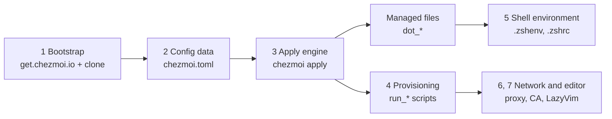
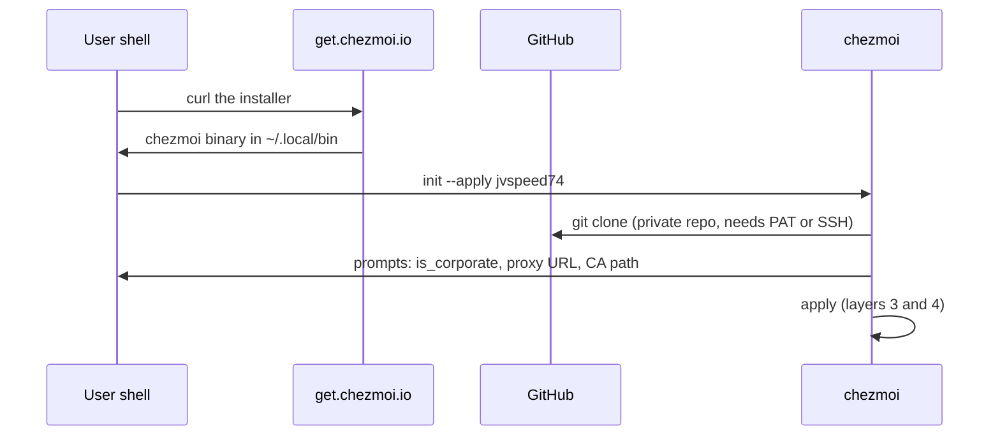
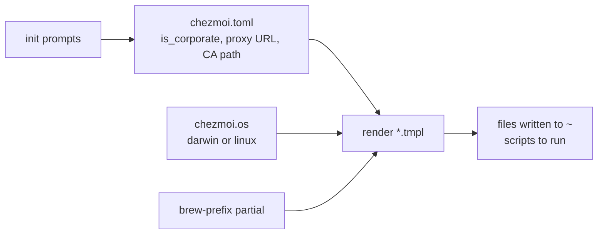
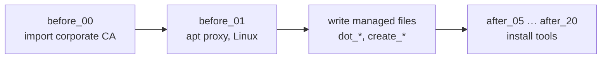
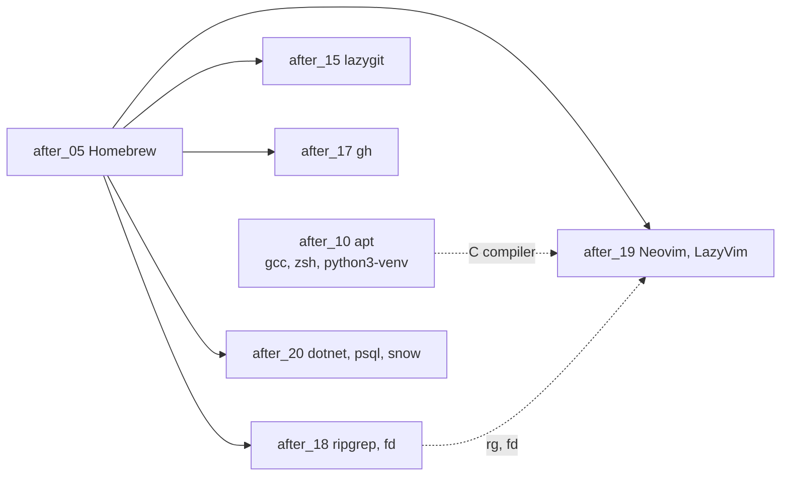
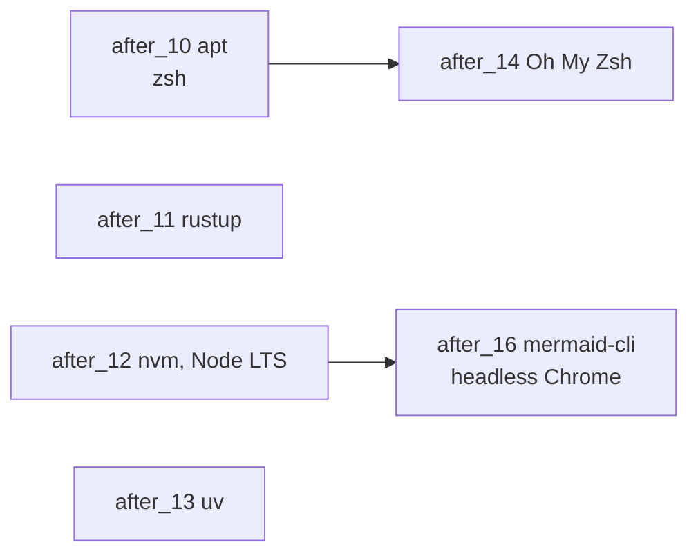
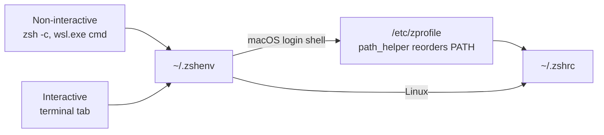
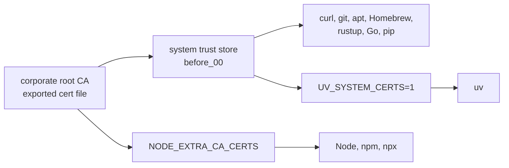
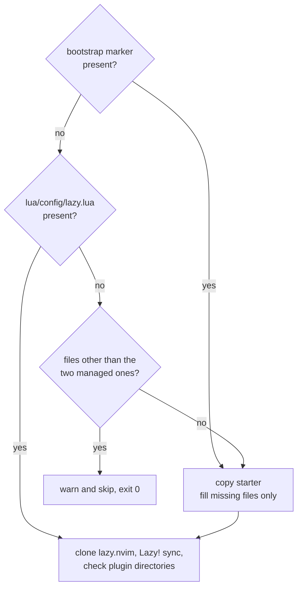
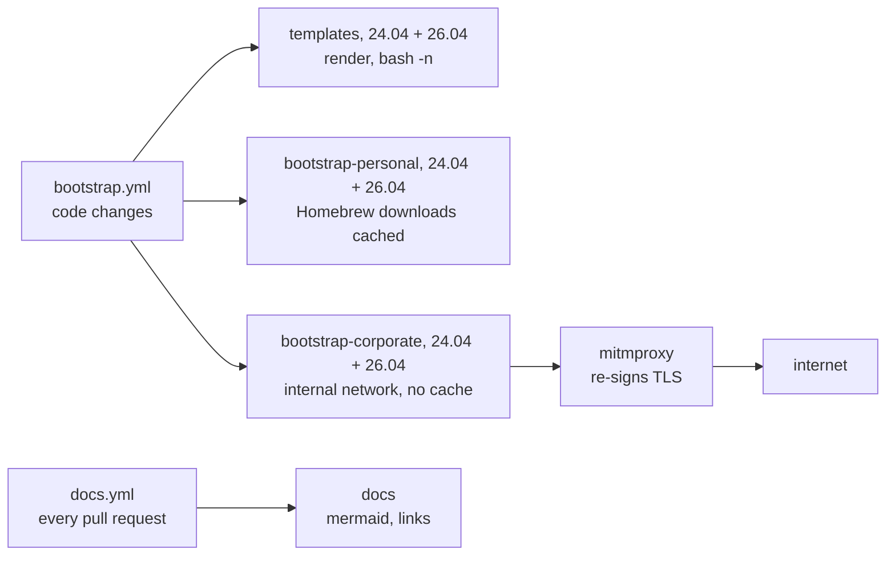

# Architecture

How a fresh macOS (Apple Silicon) or WSL2 Ubuntu 24.04 or 26.04 machine becomes a provisioned
workstation, one layer at a time, in the order things happen. For tasks, see [GUIDE.md](GUIDE.md);
for changing the code, see [CONTRIBUTING.md](CONTRIBUTING.md).

## Layer map

Each layer consumes the output of the one before it. Layer 8 (CI) runs layers 1–7 in fresh
containers on every pull request.

Every layer below uses the same sections: **Responsibility**, **Files**, **Flow**, **Invariants**,
**Failure modes**.

## Glossary

| Term | Meaning here |
|---|---|
| Source state | This repo, checked out at `~/.local/share/chezmoi`. |
| Target | The file chezmoi writes in `~`. `dot_zshrc.tmpl` → `~/.zshrc`. |
| Template | A source file ending in `.tmpl`, rendered with Go templates before it is written or run. |
| Partial | A reusable template fragment in `.chezmoitemplates/`, included with `{{ template "name" . }}`. |
| `run_once_` | Script that runs once per unique rendered content: again if its content changes or it last failed. |
| `run_onchange_` | Script that runs whenever its rendered content differs from its last successful run. |
| `before_` / `after_` | Script phase: before any file is written, or after all files are written. |
| `create_` | File written only when the target is missing; never overwritten afterwards. |

## 1. Bootstrap

**Responsibility:** get the chezmoi binary and this repo onto a machine that has neither.

**Files**

| Item | Role |
|---|---|
| `get.chezmoi.io` (external) | Shell installer. `-b "$HOME/.local/bin"` puts `chezmoi` in `~/.local/bin` (default: `./bin` relative to the current directory), then runs `chezmoi init --apply <repo>`. |
| GitHub `jvspeed74/dotfiles` | Cloned into the source state. The repo is private, so the clone needs credentials. |
| `.chezmoi.toml.tmpl` | Defines the questions `init` asks (layer 2). |

**Flow**

Every network call above happens before any repo script runs, so on a corporate network the shell
must already have the proxy and trust the corporate CA.

**Invariants**

- Run in an interactive terminal: `init` prompts, and several scripts call `sudo`.
- Nothing in the repo can help before the clone finishes; corporate prerequisites are manual
  ([GUIDE: corporate WSL preconditions](GUIDE.md#corporate-wsl-preconditions)).

**Failure modes**

| Symptom | Cause | Where handled |
|---|---|---|
| `curl` or `git clone` fails with a certificate error | Corporate CA not yet trusted | [GUIDE: corporate WSL preconditions](GUIDE.md#corporate-wsl-preconditions) |
| `git clone` asks for a username, or fails | Private repo, no credentials | [GUIDE: clone the private repo](GUIDE.md#clone-the-private-repo) |
| Bootstrap hangs | Run non-interactively (piped, CI, cron) | Run it in a real terminal |
| `xcrun: error`, or a developer-tools dialog, on a fresh Mac | Command Line Tools missing; the clone calls the `/usr/bin/git` stub | [GUIDE: personal machine](GUIDE.md#personal-machine), step 0 |
| Existing dotfiles replaced without a prompt | No previous chezmoi state to compare against, so the first apply overwrites | [GUIDE: existing machine](GUIDE.md#existing-machine) |

## 2. Config data and templating

**Responsibility:** record per-machine facts once, then render every file and script from them.

**Files**

| File | Role |
|---|---|
| `.chezmoi.toml.tmpl` | Prompts with `promptBoolOnce` / `promptStringOnce` and writes the answers to `[data]`. |
| `~/.config/chezmoi/chezmoi.toml` | The answers. Local to the machine; never committed. |
| `.chezmoitemplates/brew-prefix` | Homebrew prefix per OS: `/opt/homebrew` or `/home/linuxbrew/.linuxbrew`. |
| `*.tmpl` | Every templated file and script. |

**Flow**

Two inputs decide every rendered line: the machine's answers and its OS.

| Data key | Values | Used by |
|---|---|---|
| `is_corporate` | `true` / `false` | Every `{{ if .is_corporate }}` block: proxy, CA trust, telemetry opt-outs |
| `corporate_proxy_url` | e.g. `http://proxy.corp.example:8080` | `.zshenv`, `.gitconfig`, `.npmrc`, `.cargo/config.toml`, apt, every install script |
| `corporate_ca_cert_source_path` | Path to the exported root CA | `before_00`; `NODE_EXTRA_CA_CERTS` on macOS |
| `.chezmoi.os` (built in) | `darwin` / `linux` | OS branches and the `brew-prefix` partial |

**Invariants**

- Corporate-only content sits inside `{{ if .is_corporate }}`, so personal machines render none of it.
- OS-dependent paths come from a partial, never from a hardcoded path in several files.
- `promptBoolOnce` / `promptStringOnce` ask only when a key is missing from `chezmoi.toml`.

**Failure modes**

| Symptom | Cause | Where handled |
|---|---|---|
| Machine switched to corporate, but no proxy prompts | The keys already exist (empty) from the first `init` | [GUIDE: switch a personal machine to corporate](GUIDE.md#switch-a-personal-machine-to-corporate) |
| Corporate setting appears on a personal machine | Content placed outside the `is_corporate` block | CI `templates` job: personal-render checks |

## 3. Apply engine and ordering

**Responsibility:** write managed files and run scripts in a fixed order on every `chezmoi apply`.

**Files:** every `run_*` script and every `dot_*` / `create_*` file in the repo root.

**Flow**

The phase comes from the `before_` / `after_` infix; within a phase, scripts run in ASCII order of
their target name, which is the file name with the `run_`, `once_`/`onchange_`, and
`before_`/`after_` prefixes removed. So an `onchange` script numbered `05` runs before a `once`
script numbered `10`: the number orders scripts within a phase, the once/onchange attribute does not.

| Prefix | Runs | Used for |
|---|---|---|
| `run_onchange_before_` | Before files; again whenever its rendered content changes | `before_00` (CA), `before_01` (apt proxy): rerun if the proxy URL or CA path changes |
| `run_once_after_` | After files; once per unique rendered content, and again after a failure | All tool installs (`after_05`–`after_20`) |

**Invariants**

- Every script names its phase with `before_` or `after_`.
- Every script is idempotent: a content change re-runs it on every machine already provisioned.
- A script exits non-zero when its self-check fails, so chezmoi retries it on the next apply.
- Scripts run under `bash` in their own process: nothing exported by one script reaches the next.

**Failure modes**

| Symptom | Cause | Where handled |
|---|---|---|
| A script runs again on every apply | It keeps failing; `run_once_` records success only | Fix the failure; see its error output |
| An edited script re-runs on all machines | Its rendered content changed | Expected; scripts are idempotent ([CONTRIBUTING R6](CONTRIBUTING.md#r6-change-an-existing-run_once_-script)) |
| A tool is missing in a later script | That script assumed an earlier script's environment | Each script evals `brew shellenv` itself |

## 4. Provisioning scripts

**Responsibility:** install every tool, then prove it runs before reporting success.

**Files**

| Script | Installs | OS | Self-check |
|---|---|---|---|
| `run_once_after_05-install-homebrew.sh.tmpl` | Homebrew (Linux: apt prerequisites first; corporate: analytics off) | both | `brew` on PATH |
| `run_once_after_10-install-apt-packages.sh` | build-essential, unzip, golang-go, Chrome libs, python3-venv, zsh, then `chsh` to zsh | Linux | gcc, go, unzip, zsh, `import ensurepip`, login shell |
| `run_once_after_11-install-rustup.sh.tmpl` | rustup + cargo (`--no-modify-path`) | both | `rustc`, `cargo` |
| `run_once_after_12-install-nvm-node.sh.tmpl` | nvm + Node LTS | both | `node --version` |
| `run_once_after_13-install-uv.sh.tmpl` | uv | both | `uv --version` |
| `run_once_after_14-install-oh-my-zsh.sh.tmpl` | Oh My Zsh + autosuggestions + syntax highlighting (`KEEP_ZSHRC=yes`) | both | plugin directories |
| `run_once_after_15-install-lazygit.sh.tmpl` | lazygit (brew) | both | `lazygit --version` |
| `run_once_after_16-install-mermaid-cli.sh.tmpl` | mermaid-cli + headless Chrome | both | `mmdc --version` |
| `run_once_after_17-install-gh.sh.tmpl` | gh (brew) | both | `gh --version` |
| `run_once_after_18-install-ripgrep-fd.sh.tmpl` | ripgrep, fd (brew) | both | `rg`, `fd` |
| `run_once_after_19-install-neovim-lazyvim.sh.tmpl` | Neovim, tree-sitter-cli, fzf, Nerd Font (macOS), LazyVim starter + plugins | both | Neovim ≥ 0.11.2, plugin directories |
| `run_once_after_20-install-dev-clients.sh.tmpl` | .NET SDK, psql (libpq), Snowflake CLI | both | `dotnet`, `psql`, `snow` |

**Flow: system and Homebrew tools**

Homebrew is the root for most tools; LazyVim additionally needs the C compiler from apt and
ripgrep/fd. Solid arrows install with; dashed arrows are runtime needs.

**Flow: language runtimes and shell**

Runtimes install from their own upstream installers, independent of Homebrew; only Oh My Zsh and
mermaid-cli depend on an earlier script.

**Invariants**

- Every install ends with a check that the tool runs; a failed check exits non-zero.
- Scripts that call `brew` evaluate `brew shellenv` themselves (layer 3, last invariant).
- No installer may edit a chezmoi-managed file: rustup uses `--no-modify-path`, Oh My Zsh uses
  `KEEP_ZSHRC=yes`, and nvm finds the `/nvm.sh` and `$NVM_DIR/bash_completion` strings it greps for in
  `.zshrc`'s lazy `nvm` function, so it appends nothing.

**Failure modes**

| Symptom | Cause | Where handled |
|---|---|---|
| `chezmoi status` shows `~/.zshrc` or `~/.zshenv` modified after bootstrap | An installer appended to a managed file | CI: "chezmoi status is clean" check |
| `brew: command not found` inside a script | Script did not evaluate `brew shellenv` | Pattern in `after_15`–`after_20` |
| Old binary shadows the Homebrew one | `~/.local/bin` precedes Homebrew on PATH | `after_10` and `after_15` remove the old `fd` symlink and `lazygit` binary |

## 5. Shell environment

**Responsibility:** give every kind of zsh, interactive or not, the same tools and settings.

**Files**

| File | Contents | Read by |
|---|---|---|
| `dot_zshenv.tmpl` → `~/.zshenv` | `_dotfiles_path_prepend` and `typeset -U path PATH`, corporate proxy and CA variables, cargo env, Homebrew on Linux, `EDITOR`/`VISUAL`, `DOTNET_ROOT`, libpq on PATH, the newest nvm Node bin (`NVM_DIR`), then `~/.local/bin` ahead of Homebrew and system dirs | Every zsh |
| `dot_zshrc.tmpl` → `~/.zshrc` | Homebrew on macOS, `~/.local/bin` and `/usr/local/bin` if missing (unconditionally in macOS login shells, after `path_helper`), the `nvm` command (loaded on first use), Oh My Zsh | Interactive zsh only |

**Flow**

Anything a non-interactive command needs must live in `~/.zshenv`; `~/.zshrc` is only for
interactive shells.

**Invariants**

- Variables used by scripts, editors, or `wsl.exe <cmd>` go in `.zshenv`.
- Homebrew's `shellenv` runs in `.zshenv` on Linux but in `.zshrc` on macOS: macOS's
  `path_helper` would reorder anything `.zshenv` puts on PATH for login shells.
- `.zshenv` refers to Homebrew tools by absolute path behind `[[ -x … ]]` guards, so it works
  before Homebrew is on PATH and when a tool is not installed.
- `~/.local/bin` precedes Homebrew and the system directories in every fresh zsh: `.zshenv` adds
  it last, and `.zshrc` re-adds it after macOS `path_helper`. `typeset -U path PATH` keeps each
  entry once. It also precedes the nvm Node bin. It is the only user bin directory; `~/bin` is not
  on PATH.
- Node comes from `.zshenv`: the newest installed nvm version (numeric sort), in every zsh. New
  shells use it, not nvm's `default` alias; a shell that already has an nvm Node on PATH keeps it,
  so children inherit a parent's `nvm use`. `.zshrc` defines `nvm` as a function that loads nvm on
  first call, so shell startup does not pay for it.
- PATH additions in `.zshenv` and `.zshrc` go through `_dotfiles_path_prepend`, which skips
  directories already on PATH, and Homebrew's `shellenv` is skipped when Homebrew is already on
  PATH. A nested zsh therefore keeps its parent's order: an activated venv stays first. The only
  exception is macOS login shells, which prepend unconditionally after `path_helper`.

**Failure modes**

| Symptom | Cause | Where handled |
|---|---|---|
| A tool works in a terminal but not in `wsl.exe <cmd>` | Its setup is in `.zshrc` | Move it to `.zshenv` ([CONTRIBUTING rules](CONTRIBUTING.md#rules-that-keep-machines-working)) |
| A nested shell (`:!cmd` in Neovim, `zsh` inside an activated venv) finds `~/.local/bin` or Homebrew tools before the venv's | An rc file prepended unconditionally | `_dotfiles_path_prepend`; CI checks both nested cases |
| `nvm alias default` has no effect in new shells | `.zshenv` puts the newest installed Node on PATH | `nvm use <version>` per shell, or `nvm uninstall` the newer version |
| `/etc/environment` settings are ignored | WSL starts shells without a PAM session ([microsoft/WSL#9213](https://github.com/microsoft/WSL/issues/9213)) | Not used; `.zshenv` instead |

## 6. Corporate network

**Responsibility:** make every tool reach the internet through the proxy and trust the corporate
CA that re-signs TLS traffic.

**Files:** `run_onchange_before_00-import-ca-cert.sh.tmpl`,
`run_onchange_before_01-configure-apt-proxy.sh.tmpl`, the corporate blocks in `dot_zshenv.tmpl`,
`dot_gitconfig.tmpl`, `dot_npmrc.tmpl`, `dot_cargo/config.toml.tmpl`, and every install script.

**Flow: CA trust**

Most tools read the system store; Node ships its own CA list and uv its own roots, so each gets a
variable pointing it at the corporate CA.

`before_00` installs the CA into `/usr/local/share/ca-certificates/` (Linux) or the System keychain
(macOS). On Linux, `NODE_EXTRA_CA_CERTS` points at that copy; on macOS, at the exported file.

**Proxy settings per tool**

| Tool | Where it reads the proxy |
|---|---|
| apt | `/etc/apt/apt.conf.d/95corporate-proxy` (`before_01`) |
| git | `[http] proxy` in `~/.gitconfig`, and the environment |
| npm | `proxy` / `https-proxy` in `~/.npmrc` |
| cargo | `[http] proxy` in `~/.cargo/config.toml` |
| curl, Homebrew, pip, uv, Go, rustup | `http_proxy` / `https_proxy` (both cases) from `.zshenv`; install scripts export the uppercase pair |
| Puppeteer's browser download | Same variables, honored only because `after_16` adds `proxy-agent` |

**Invariants**

- Every corporate setting is inside `{{ if .is_corporate }}`.
- Telemetry is off on corporate machines: Homebrew (`brew analytics off`) and .NET
  (`DOTNET_CLI_TELEMETRY_OPTOUT=1`).
- Downloads before the repo is cloned rely on the user's shell (layer 1).

**Failure modes**

| Symptom | Cause | Where handled |
|---|---|---|
| Certificate error from Node or npm | `NODE_EXTRA_CA_CERTS` missing in that process | `.zshenv`, and `after_16` exports it for its own run |
| Certificate error from uv | `UV_SYSTEM_CERTS` missing | `.zshenv` |
| WSL cannot reach a proxy on `127.0.0.1` | WSL2 NAT networking | [GUIDE: corporate WSL preconditions](GUIDE.md#corporate-wsl-preconditions) (mirrored networking) |

## 7. Editor: Neovim and LazyVim

**Responsibility:** install Neovim and a LazyVim config with plugins ready, without ever
overwriting an existing config.

**Files**

| File | Role |
|---|---|
| `run_once_after_19-install-neovim-lazyvim.sh.tmpl` | Installs Neovim, bootstraps the LazyVim starter, syncs plugins. |
| `dot_config/nvim/create_lazyvim.json` | Seeds the enabled LazyVim Extras. `create_`: written only if missing. |
| `dot_config/nvim/lua/plugins/sql.lua` | Makes SQLFluff take its dialect from the nearest `.sqlfluff` instead of a hardcoded `ansi`. |
| `dot_sqlfluff` → `~/.sqlfluff` | Default SQL dialect: `ansi`. |

**Flow**

An existing config always wins: any unmanaged file in `~/.config/nvim` stops the bootstrap.

**Invariants**

- `managed_re` in `after_19` lists every file chezmoi manages under `~/.config/nvim`; CI fails if
  it does not.
- The marker `~/.config/nvim/.lazyvim-bootstrap-incomplete` exists only while the starter is being
  copied, so an interrupted copy resumes instead of being mistaken for a user config.
- `lazy.nvim` is cloned by the script, not by the starter: the starter waits for a keypress if its
  clone fails, which would hang an unattended run.
- Language servers, formatters, and parsers install on the first interactive launch, not during
  bootstrap.

**Failure modes**

| Symptom | Cause | Where handled |
|---|---|---|
| Bootstrap printed "skipping" | `~/.config/nvim` held another config | [GUIDE: re-run the LazyVim bootstrap](GUIDE.md#re-run-the-lazyvim-bootstrap) |
| `:LazyExtras` changes not synced to other machines | `lazyvim.json` is create-only | [GUIDE: change LazyVim Extras](GUIDE.md#change-lazyvim-extras) |
| SQL formatted with the wrong dialect | No `.sqlfluff` above the file | [GUIDE: set a SQL dialect per project](GUIDE.md#set-a-sql-dialect-per-project) |

## 8. Verification (CI)

**Responsibility:** run layers 1–7 from scratch on every pull request, including behind a
TLS-intercepting proxy.

**Files:** `.github/workflows/bootstrap.yml`, `.github/workflows/docs.yml`, `.github/ci/Dockerfile`, `.github/ci/templates.sh`,
`.github/ci/run-bootstrap.sh`, `.github/ci/in-container.sh`, `.github/ci/docs.sh`,
`.github/ci/check_links.py`.

**Flow**

The corporate job's container has no route out except mitmproxy, so any tool that ignores the
proxy or the corporate CA fails the job. It never uses a cache: a cache hit would skip the very
downloads it tests.

| Workflow | Runs on |
|---|---|
| `bootstrap.yml` | Pull requests touching `dot_*`, `run_*`, `.chezmoi*`, or `.github/**` (except the docs checker files); manual runs |
| `docs.yml` | Every pull request; manual runs |

| Job | Proves |
|---|---|
| `templates` | In both `ubuntu:24.04` and `ubuntu:26.04`: every template renders for both profiles; every script passes `bash -n`; key lines are present or absent per OS and profile. |
| `bootstrap-personal` | A full bootstrap succeeds in both `ubuntu:24.04` and `ubuntu:26.04`; tools resolve; `chezmoi status` is clean; a second apply changes nothing. Homebrew downloads come from a weekly cache; every install step still runs. |
| `bootstrap-corporate` | The same through the intercepting proxy, plus CA and proxy behavior per tool, with negative controls. |
| `docs` | Every Mermaid diagram renders; every relative link, anchor, and backticked repo path resolves. |
| `macos` (manual) | macOS template renders; the `gh` credential helper with a minimal PATH. |

**Invariants**

- Bootstrap jobs run in containers: the hosted runner already has most tools, which would hide
  install failures.
- Check labels name the area they cover (for example `nvim:`).

## Known gaps

| Gap | Effect |
|---|---|
| No `no_proxy` | On corporate machines, requests to `localhost` and internal hosts also go to the proxy. |
| VS Code Remote-WSL server | Reads no shell startup files, so it gets no proxy. |
| macOS `pip` behind the corporate proxy | Untested. |
| First Neovim launch (language servers, parsers, .NET tools) | Not exercised by CI. |
| macOS bootstrap, end to end | Never run in CI; only macOS template rendering is checked, by the manual `macos` job. |
| Intel Macs, non-Debian Linux | Not supported: `/opt/homebrew` and apt are assumed. |
